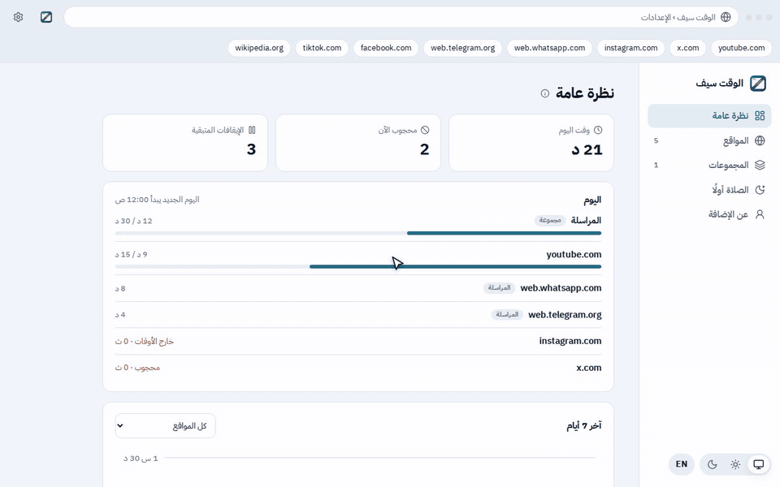
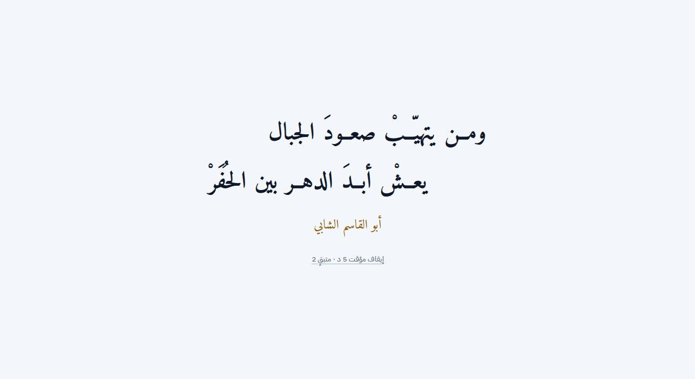
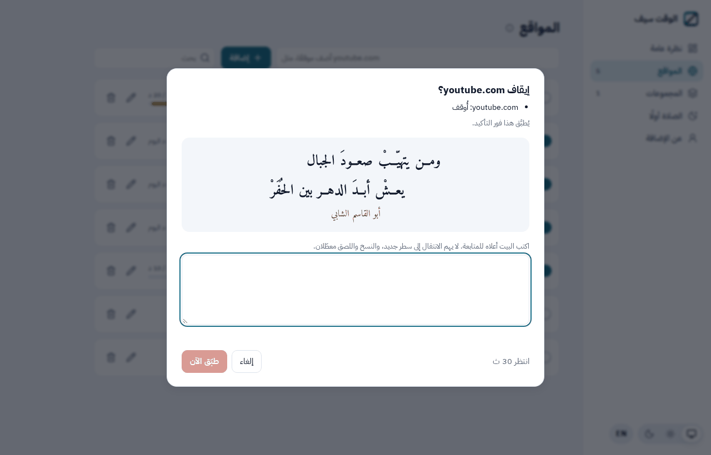
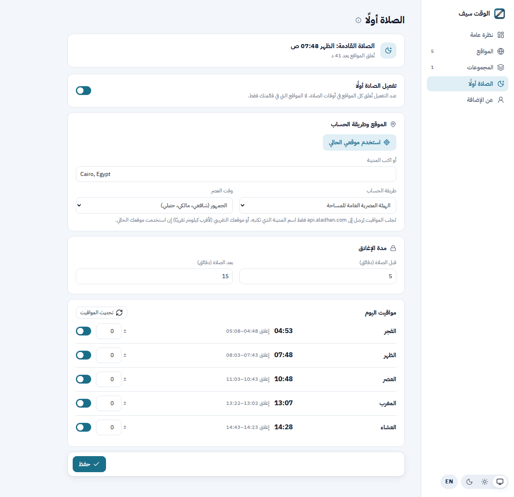
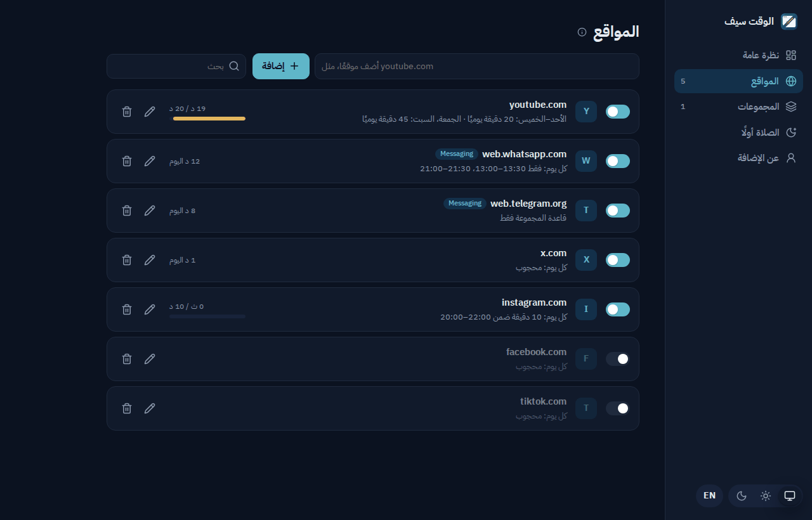
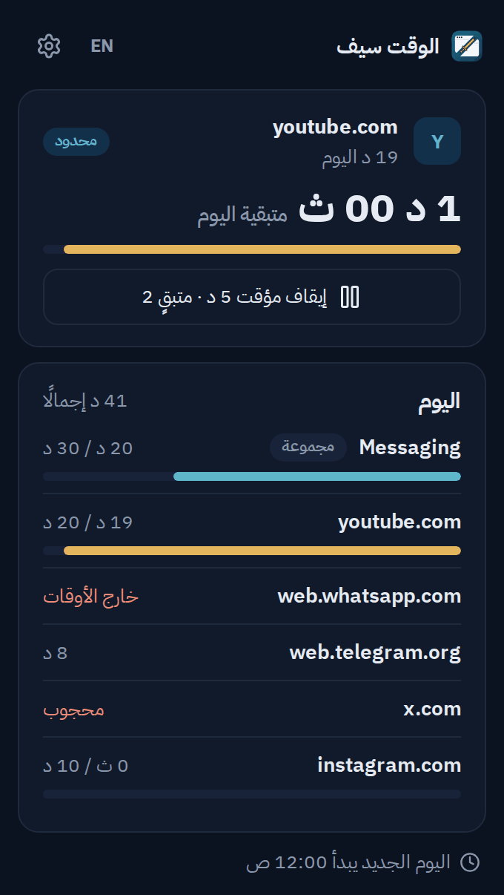
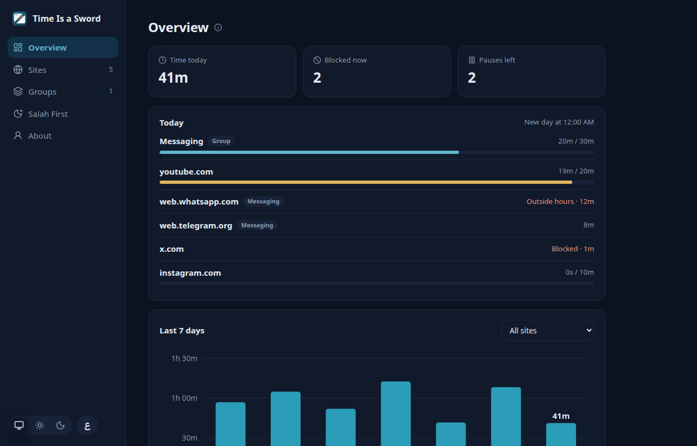

# الوقت سيف · Time Is a Sword

**إضافة متصفح تحمي وقتك: تحجب المواقع المشتّتة أو تحدّ وقتها، وتغلق المواقع وقت الصلاة، وتذكّرك بقيمة الوقت.**
 
A browser extension that guards your time: it blocks or time-limits distracting sites, closes websites at prayer time, and reminds you of the value of time.

[العربية](#العربية) · [English](#english)

 
🎬 <a href="media/time-is-a-sword-demo.mp4">شاهد الفيديو بجودة أعلى</a> · <a href="media/time-is-a-sword-demo.mp4">Watch in higher quality</a>

---

## العربية

> «نعمتان مغبون فيهما كثير من الناس: الصحة والفراغ» — رواه البخاري

**الوقت سيف** إضافة لمتصفحات كروم وبريف وإيدج تساعدك على ألّا يضيع يومك في التنقّل بين المواقع. تضع لكل موقع قاعدته، وتحسب وقتك الفعلي بدقة، وحين ينتهي الوقت تُغلق الموقع وتعرض لك حديثًا أو أثرًا أو بيت شعر عن قيمة الوقت.

### المميزات

- **قواعد لكل موقع:** حجب دائم، أو حدّ يومي بالدقائق، أو ساعات مسموحة فقط، أو الاثنان معًا، ولكل يوم من أيام الأسبوع قاعدته الخاصة.
- **المجموعات:** مواقع تتشارك وقتًا واحدًا (مثل واتساب وتيليجرام)، فلا تكسب وقتًا إضافيًا بالتنقّل بينها.
- **حساب دقيق للوقت:** يُحسب الوقت فقط حين تكون الصفحة أمامك وتستخدمها فعلًا، أو حين يعمل فيها فيديو، ولا يُحسب مرتين إن فتحت الموقع في عدة تبويبات.
- **الصلاة أولًا:** قبل كل صلاة بخمس دقائق تُغلق كل المواقع ويظهر حديث عن الصلاة، ثم تُفتح بعد الصلاة بربع ساعة. المواقيت حسب موقعك أو مدينتك، وكل ذلك قابل للتعديل.
- **حاجز ضد التحايل:** أي تغيير يخفّف القواعد (رفع حد، إيقاف موقع، حذفه…) يحتاج إلى عدّ تنازلي 30 ثانية وكتابة تذكير كما هو، دون نسخ ولصق.
- **إيقاف مؤقت محدود:** 5 دقائق، 3 مرات في اليوم، بنفس الحاجز.
- **تنبيهات:** بطاقة صغيرة داخل الموقع حين يبقى 5 دقائق ثم دقيقة.
- **صفحة الحجب:** تذكير واحد بخط جميل، والشعر يُعرض أبياتًا بشطرين ممدودين كما في الدواوين.
- **عربية أولًا:** الواجهة بالعربية من اليمين لليسار، مع الإنجليزية بضغطة زر، ووضع فاتح وداكن.

### لقطات

### التثبيت

1. حمّل المشروع: زر **Code ← Download ZIP** ثم فك الضغط، أو `git clone https://github.com/mahm0udnasr/time-is-a-sword.git`.
2. افتح `brave://extensions` أو `chrome://extensions` أو `edge://extensions`.
3. فعّل **وضع المطوّر** (Developer mode).
4. اضغط **Load unpacked** واختر مجلد المشروع.
5. ثبّت أيقونة الإضافة في شريط الأدوات، وافتح الإعدادات لتفعيل المواقع التي تريدها.

يحتاج كروم 120 أو أحدث (أو بريف/إيدج المبني عليه).

### الخصوصية

([سياسة الخصوصية](PRIVACY.md)) كل بياناتك تبقى على جهازك داخل التخزين المحلي للمتصفح: لا خوادم، ولا تحليلات، ولا حسابات. الاستثناء الوحيد هو **الصلاة أولًا**: لجلب المواقيت يُرسَل إلى [api.aladhan.com](https://aladhan.com/prayer-times-api) اسم المدينة الذي تكتبه، أو موقعك التقريبي (لأقرب كيلومتر تقريبًا) إن ضغطت «استخدم موقعي الحالي»، ولا شيء غير ذلك.

### المساهمة

المشروع مفتوح المصدر، والمساهمات مرحّب بها:

- **وجدت مشكلة أو لديك فكرة؟** افتح [Issue](https://github.com/mahm0udnasr/time-is-a-sword/issues).
- **تذكيرات جديدة:** أضفها في `data/quotes.json` مع مصدرها، وتحرَّ صحة الحديث ونسبة الأثر.
- **تعديل الكود:** لا يوجد build ولا مكتبات؛ اقرأ [ملاحظات التطوير](docs/DEVELOPMENT.md)، وشغّل الاختبارات بـ `node tests/run.mjs` قبل إرسال Pull Request.

### المطوّر

**محمود نصر**: طالب نظم معلومات الأعمال، ينتقل من تطوير الويب إلى تعلّم الآلة والذكاء الاصطناعي.
 
[الموقع الشخصي](https://mahm0udnasr.vercel.app/) · [GitHub](https://github.com/mahm0udnasr) · [LinkedIn](https://linkedin.com/in/mahm0udnasr) · [Telegram](https://t.me/mahm0udnasr) · [Kaggle](https://kaggle.com/mahm0udnasr)

لا تنسونا من صالح دعائكم.

---

## English

> “There are two blessings in which many people are deceived: health and free time.” — Sahih al-Bukhari

**Time Is a Sword** (الوقت سيف) is an extension for Chrome, Brave and Edge that keeps your day from dissolving into endless tabs. Give each site its own rule; it measures the time you actually spend, and when time is up it closes the site and shows a hadith, a saying of the salaf or a line of poetry about the value of time.

### Features

- **Per-site rules:** always blocked, a daily limit in minutes, allowed hours only, or both, with a different rule for each day of the week if you like.
- **Groups:** sites that share one budget (e.g. WhatsApp + Telegram), so switching between them doesn't buy extra time.
- **Accurate tracking:** time counts only while the page is in front of you and you're using it (or a video plays in it), and never twice for a site open in several tabs.
- **Salah First:** five minutes before each prayer every website closes and a hadith about salah appears; they open again fifteen minutes after. Times follow your location or city, and everything is adjustable.
- **Anti-cheat:** any change that loosens your rules (raising a limit, switching a site off, removing it…) needs a 30-second countdown and typing a reminder exactly, with copy and paste disabled.
- **Limited pauses:** 5 minutes, 3 times a day, behind the same step.
- **Warnings:** a small card inside the site at 5 minutes and 1 minute left.
- **Blocked page:** a single reminder in beautiful Arabic type; poetry is set as verses, stretched with kashida like a printed diwan.
- **Arabic first:** right-to-left Arabic interface with English one click away; light and dark themes.

### Install

1. Get the code: **Code → Download ZIP** and unzip it, or `git clone https://github.com/mahm0udnasr/time-is-a-sword.git`.
2. Open `chrome://extensions` (Brave: `brave://extensions`, Edge: `edge://extensions`).
3. Turn on **Developer mode**.
4. Click **Load unpacked** and choose the project folder.
5. Pin the toolbar icon and open Settings to switch on the sites you want.

Requires Chrome 120 or newer (or Brave/Edge built on it).

### Privacy

Everything stays on your device, in the browser's local storage: no servers, no analytics, no accounts. The one exception is **Salah First**: to get prayer times it sends [api.aladhan.com](https://aladhan.com/prayer-times-api) the city you type, or your approximate location (to about 1 km) if you press “Use my location”, and nothing else. Full details: [privacy policy](PRIVACY.md).

### Permissions

| Permission | Why |
|---|---|
| `storage` | Saves your sites, rules and usage locally. |
| `tabs`, `webNavigation` | Sees which site a tab is on, and sends blocked tabs to the reminder page. |
| `alarms`, `idle` | Saves time every 30 s, acts at the exact moment a limit or prayer lock starts, resets daily. |
| `scripting` + site access | Runs a tiny script **only on the sites in your list** to know if the page is in use, and shows the warning card. |
| `geolocation` | Only for “Use my location” in Salah First, and only when you press it. |

### Contributing

Contributions are welcome:

- **Found a bug or have an idea?** Open an [issue](https://github.com/mahm0udnasr/time-is-a-sword/issues).
- **New reminders:** add them to `data/quotes.json` with their source; please check the hadith's authenticity and the attribution.
- **Code:** no build step and no dependencies. Read the [development notes](docs/DEVELOPMENT.md) and run `node tests/run.mjs` before opening a pull request. `node tools/package.mjs` builds the store ZIP; the store texts live in [`store/listing.md`](store/listing.md).

### Credits

[Amiri](https://github.com/aliftype/amiri) and [IBM Plex Sans Arabic](https://github.com/IBM/plex) fonts (SIL OFL) · [Lucide](https://lucide.dev) icons (ISC) · [Simple Icons](https://simpleicons.org) (CC0) · prayer times by the [Aladhan API](https://aladhan.com/prayer-times-api).

### Author

**Mahmoud Nasr**: BIS student, transitioning from web development to machine learning & AI.
 
[Website](https://mahm0udnasr.vercel.app/) · [GitHub](https://github.com/mahm0udnasr) · [LinkedIn](https://linkedin.com/in/mahm0udnasr) · [Telegram](https://t.me/mahm0udnasr) · [Kaggle](https://kaggle.com/mahm0udnasr)

 

### License

[MIT](LICENSE) © 2026 Mahmoud Nasr. Fonts and icons keep their own licences (see [THIRD_PARTY_NOTICES.md](THIRD_PARTY_NOTICES.md)).
